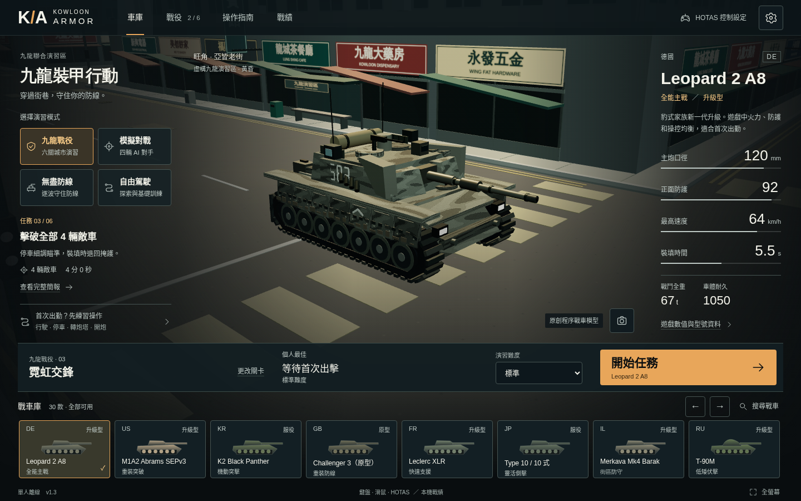
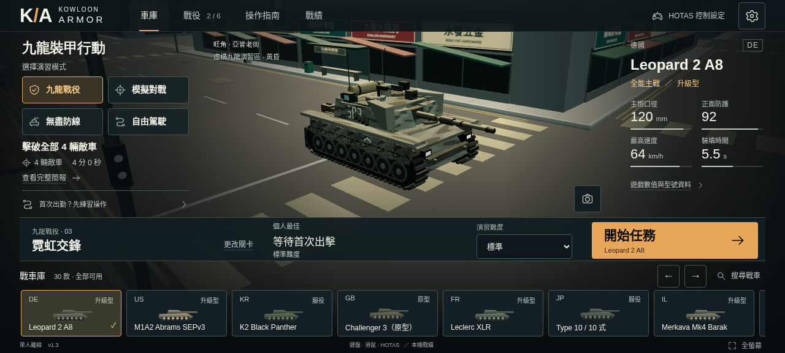
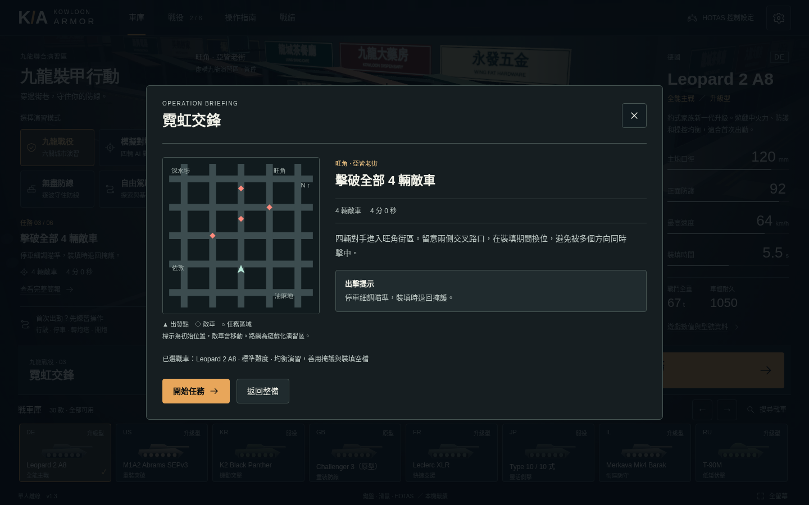
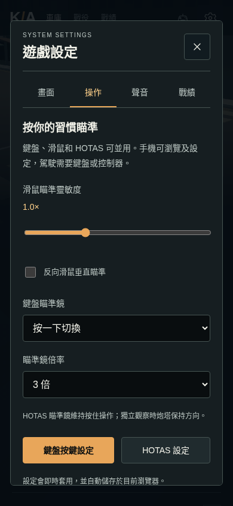
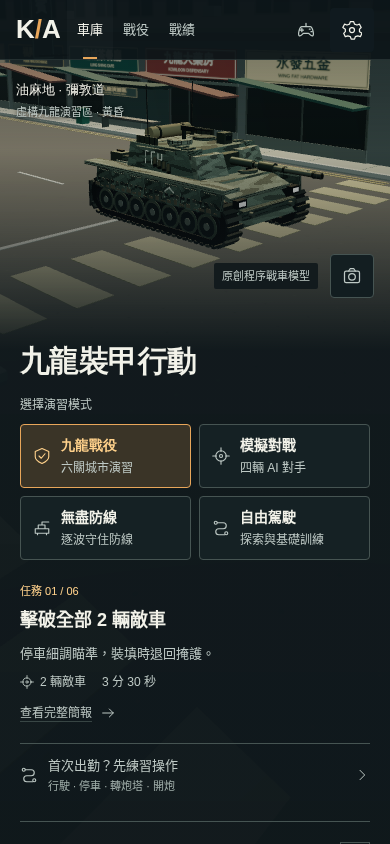

# 1.3 出擊整備驗收

日期：2026-10-12。基準：`b0beeb3`。實作／驗收代理為 gpt-6-astra、max；另由同樣配置的唯讀覆核代理檢查流程與資料安全。未取得完整 token 用量，不推算缺漏資料。

## 改動與保留

- 車庫改為有界資訊欄、中央真實戰車、獨立出擊列及穩定戰車庫；按視窗高度精簡資訊，不以絕對定位互相蓋住按鈕。手機採縱向瀏覽，展示相機按可用空間調整。
- 出擊簡報呈現實際路網、起點、敵軍初始位置與目標；記住選車、模式、關卡。目錄提供搜尋、車重篩選及性能排序，沒有改動 30 車的數值或可用性。
- 畫面／操作／聲音／戰績分頁，鍵盤切換、明確返回與固定關閉位置；主動離開未完成演習須確認。
- 版本化 JSON 戰績備份：驗證、預覽、確認後取兩邊較高值，重複匯入不累加勝場。損壞主紀錄可讀取上一次有效副本，讀寫失敗有可見提示。
- 可選四步實際駕駛訓練；戰後報告顯示目標結果、前次紀錄、原因及下一步。HUD 有耐久與倒數警戒文字。
- 保留四模式、六關解鎖、裝甲／履帶／AI／目標／補給、HOTAS、安全待機、舊存檔與單檔離線。不加入帳戶、商店、多人或外部素材。

## 驗證方式

browser-act core 在本機沒有配置瀏覽器；沿用專案 Playwright，以隔離 profile 執行 Linux headless Chromium 141／SwiftShader。正式成品以 `file://` 開啟並設定離線，沒有借用私人瀏覽器。

`pnpm build` 先作 TypeScript 檢查，再產生兩份相同 HTML。`pnpm test` 包含 47 項規則測試及完整城市六關輸入式自動駕駛。`pnpm test:browser` 依次執行新增出擊流程、原有正式成品、真實受擊失敗、戰術整合及最終單檔核對。新流程使用普通點擊，不用強制點擊繞過遮擋；真正按 W／B／E／Space 完成訓練，實際下載 JSON 再上載作匯入。

戰術／受擊測試頁由同一套 Game、Input、Interface、View 建成，只加速物理步進，沒有改寫 HP、位置、裝填或勝負。正式 HTML 不含這些測試接口。六關驗證沿用 60 Hz、入門、Leopard 2 A8 的輸入式路徑，不表示所有車型及難度都已人工平衡。

### 結果與構建範圍

| 驗證 | 結果 |
| --- | --- |
| 發佈程式 TypeScript／規則 | 47 通過：9 模擬、10 原有擴充、21 戰術、7 出擊／存檔／訓練／構圖；六關輸入式勝利 |
| 完整離線出擊流程 | 14 項通過，包括六種車庫尺寸、四步訓練、分頁／改鍵、真正下載、匯入預覽／取消／合併／競態／拒絕儲存 |
| 原有正式成品 | 20 項通過；真實首關 2,910 分、下一關及重載解鎖；零瀏覽器錯誤／HTTP 素材請求 |
| 受擊失敗及返回 | 真實受擊 107.72 秒、HP 0；重試 HP 1050、時間 0；HOTAS 結果返回、Escape、鍵盤返回三項通過 |
| 戰術整合 | 8 組通過，含佔點／守區／重試、波間快裝、合成 HOTAS、雙視窗、72,000 次固定步進 |
| 最終發佈單檔 | 4 項通過；零瀏覽器錯誤／HTTP 素材請求；手機頁底選車後投影 Y 在捲動前後同為 −0.5616113543510437 |

完整正式成品長流程及效能樣本使用 SHA-256 `be57e80c88c74920cbb25763fb3013618c45cd3601f9451fc85582e7c9ac40ec`。之後只修正 `src/view.ts` 一項鏡頭 Y 計算，加上 `window.scrollY`，避免手機在頁底選車後回到頂部時展示消失。發佈 HTML 為 **1,038,475 bytes**，SHA-256 `483e501610fb7a7aad8c4f37b14a966e23370e1ef82b49608819ea5d4fdf987f`。

鏡頭修正後重跑 build、全部 47 項規則與六關、以及 `node scripts/artifact-check.mjs --framing` 的正式成品針對性驗收；**沒有聲稱在末版重跑整套較長瀏覽器流程**。最終單檔檢查涵蓋快速重開 HOTAS、真實開炮／390 HUD、捲動設定關閉及手機頁底選車後的實際 WebGL 投影。投影檢查只在瀏覽器測試注入只讀量測，不加入正式遊戲接口。

## 已重現的根因回歸

- 1280×577 出擊與戰車庫原本重疊；現時開始按鈕 y=363–423，戰車庫由 y=427 起，標題下緣 y=92.75。另檢查 1440×900、960×640、768×1024、390×844、320×568，均無水平溢出；手機的出擊列在下方，可正常捲動操作。
- 主紀錄破損時救回有效副本；不可用的儲存不會假稱匯入成功，也不先套用匯入。慢速檔案讀取不能取代後來選取的無效檔案；取消及關閉會使舊讀取失效。
- 備份拒絕過大檔案、不支援版本、負數、非有限值、未知分數鍵及危險屬性。Zod record 會忽略 `__proto__` 的情況已實際重現，另以 JSON reviver 拒絕，而非只依賴 schema。
- 結果 → 戰績 → 操作 → HOTAS 的返回曾令已結束遊戲留在凍結 HUD；覆核測試先得到 `headerReturnsGarage=false`，修正為狀態感知的關閉。返回及 Escape 均有回歸。
- HOTAS 子頁返回連結原本在焦點圈外；先重現 `backReachable=false`，再把連結放入控制設定面板，Shift+Tab 可達。
- 訓練原本會把車身轉動誤當獨立炮塔瞄準；先重現步驟 3 與預期 2 不符，再以進入步驟時的炮塔世界方向作基準。車身轉動、獨立觀察及提前瞄準都不能跳過步驟。
- 實際截圖量得短視窗訓練卡壓住一般自由駕駛目標 10 px；低高度時以訓練卡取代重複目標，非常窄短的訓練畫面亦隱藏非必要小地圖。初始及完成狀態都有位置斷言，避免訓練卡壓住耐久或地圖。
- 手機捲動 796 px 後選車，舊構圖把鏡頭偏移由 237 變成 1033，回到頂部只剩路面；修正後採文件座標，單元回歸先紅後綠。瀏覽器另量測真正送往 WebGL 的投影，並實際查看選車後截圖。

## 證據與發佈

最終結果、成品大小、兩個構建的 SHA-256 與測試數量由 [manifest](evidence/deployment/manifest.json) 記錄。`node scripts/collect-deployment-evidence.mjs` 必須確認正式／dist HTML 相同、正式檔無測試接口、報告沒有瀏覽器錯誤或 HTTP 素材請求、末版單檔驗證 SHA 相符，才收集精選報告與截圖。若長流程與末版 SHA 不同，收集器會在記憶體中只還原該鏡頭表達式、重新打包，必須逐 byte 重建出長流程構建的 SHA；不能把不同構建籠統宣稱為相同。

效能採當前 1280×800、DPR 1、平衡／流暢的車庫及自由駕駛樣本，記錄提交量與 frame time。車庫相機構圖已改變，**不把這次與 1.2 的車庫直接當作相同場景速度比較**。戰術測試另記錄有敵軍及炮火的單一狀態、72,000 次固定步進與十次重開的資源觀察。完整數據見同目錄 JSON；不以軟件繪圖速度聲稱玩家硬件 FPS。

| 長流程構建樣本（每組 12 幀） | WebGL 提交 | 三角形 | 中位數／p95 ms |
| --- | ---: | ---: | ---: |
| 平衡／車庫 | 145 | 308,350 | 566.6／616.7 |
| 平衡／自由駕駛 | 197 | 440,464 | 983.3／1016.7 |
| 流暢／車庫 | 91 | 217,482 | 499.9／616.6 |
| 流暢／自由駕駛 | 143 | 349,596 | 883.4／949.9 |

20 分鐘模擬的迴圈牆鐘約 8.19 秒，18 次回合結束／重開、207 發、173 次命中。壓力測試及再重開十次後，車庫資源均為 13 幾何、24 紋理；初始 22 紋理在載入車型後增加 2，再重開不再增加。GC 後 heap 約 17.07 → 16.93 → 16.96 MB。另取戰鬥狀態為 190 次提交、374,802 三角形、160 點及兩組煙塵；不把其 CPU 提交時間當連續作戰 FPS。

## 界限

- 尚未在 Windows、實體 HOTAS、實機高刷新率顯示器或音響設備驗收；合成 Gamepad 與輸入調度回歸不等於硬件測試。
- 手機可以瀏覽及設定，沒有觸控駕駛介面。小螢幕 HUD 檢查不代表已支援觸控遊玩。
- 20 分鐘是加速固定步進、稀疏渲染，不是連續實時作戰。該壓力迴圈停用音效；GPU／heap 只是有限觀察。單一戰鬥狀態的 CPU 提交時間未等待 GPU 完成，不能當 FPS。
- 瀏覽器內救回副本不等於外部備份；清除全部網站資料仍會刪去它。匯出不包含操作設定、HOTAS 校準或雲端同步。
- 程序模型仍是四個外形家族，並非 30 款精密複製；物理、裝甲及音效是遊戲化近似。沒有商業認證或數字品質評分宣稱。
