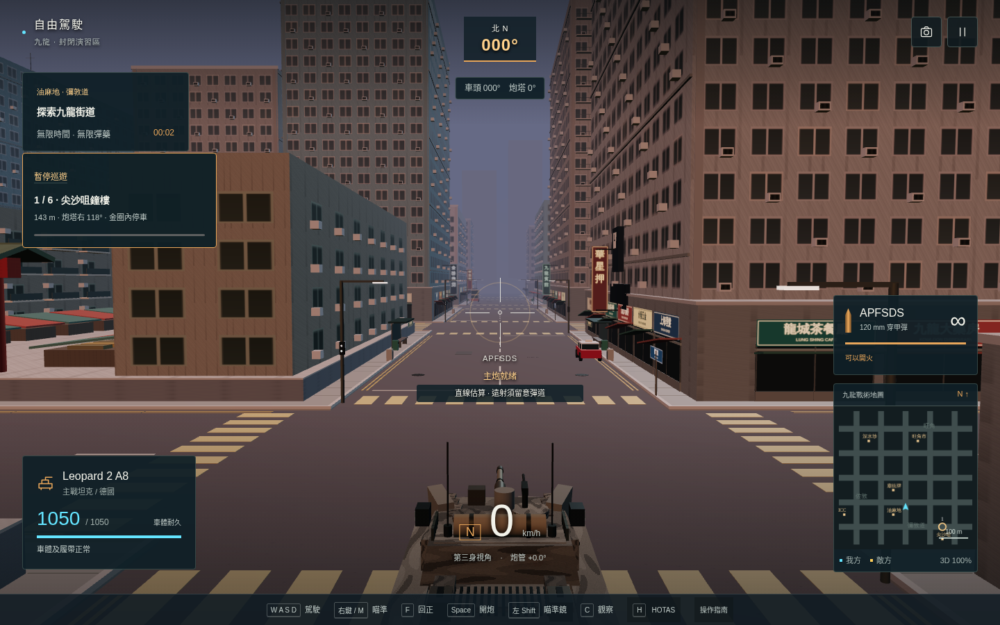
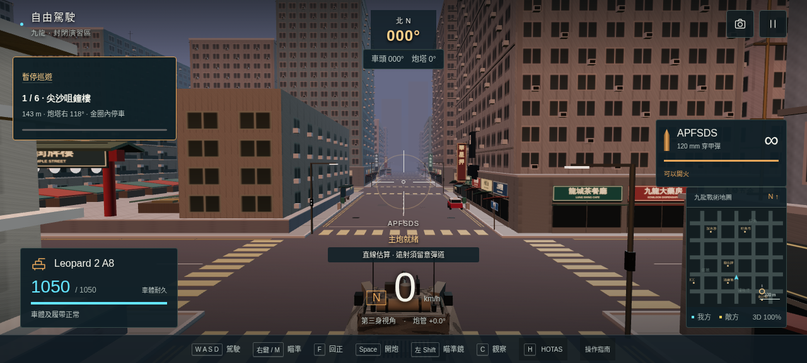

# 1.5 戰場判讀與九龍巡遊

基準：1.4 `b5043ea`。由本對話獨立實作，不委派代理。沿用用戶授權：構思後升級、測試及更新 GitHub。

## 十項設計及驗收

1. 射線提示：按炮管俯仰及實際部位碰撞，找最近命中車；顯示部位、裝甲面及炮口遮擋。明示直線估算，不承諾遠距離彈道命中。
2. 敵炮警戒：只提示 200 米內、視線暢通、炮塔已對準且即將裝填完成的敵車；不隔牆透視警報。
3. 履帶修復：顯示真正修復中或須停車收油，與物理判定一致。
4. 六地標巡遊：自由駕駛可選，六個可駛達街邊觀景點，停穩兩秒才簽到；同點不能重複累計，訓練期間不計。
5. 導航：巡遊顯示下一站、相對炮塔的左右方向、距離及小地圖目的地；任務區域亦顯示方向。這是目的地方位，不是假稱避障路線。
6. 戰後數據：實際扣除／承受耐久、側後命中及行駛距離；過量傷害不計，重開歸零，不修改原有分數。
7. 黃昏場景：可選日間／黃昏光色、霧色及方向光；保持足夠辨識度，沒有額外動態光源。
8. 自動畫面縮放：可選，持續慢幀才逐級降 3D 解像度，快速穩定後恢復；有上下限及遲滯，HUD 不縮，暫停不取樣。
9. 夜間音效：可選壓縮動態及較低輸出，保留方位和裝填提示，不影響音樂独立音量。
10. 高對比標記：可選琥珀敵軍／青色我方，搭配菱形及箭頭；同步小地圖、目標圈及受擊提示。

比較過純美術堆疊、擴大戰役、戰場判讀＋探索三個方向。採第三項，利用既有地標及機制，避免未量測便增加大量繪圖負擔。

## 實作順序

- [x] `scripts/field-check.mjs` 先驗證射線遮擋、威脅門檻、停車巡遊、紀錄歸零、自動畫質遲滯及設定遷移。
- [x] `src/field.ts`、`src/resolution.ts` 提供判定；`game.ts`、`combat.ts` 記錄回合事實。
- [x] `hud.ts`、`hud.css`、`dialogs.ts` 顯示提示／巡遊／結算；`settings.ts`、`preferences.ts`、`interface.ts` 接設定。
- [x] `view.ts`、`audio.ts` 接黃昏、縮放及夜間音效。保留預設日間、固定解像度及原音效。
- [x] 重跑完整規則及六關；離線瀏覽器測設定、巡遊、暫停、四種版面和音訊峰值；截圖人工檢視。
- 發布程序：重建單檔，記錄證據及限制，提交／推送，核對一般 Pages URL；遠端核對結果回報於對話。

保護：30 車、四模式、六關勝負條件、傷害、HOTAS 校準、舊存檔、單檔離線。無新依賴、商業素材或外部請求。Windows 顯示卡、實體 HOTAS 及真人試聽另列未驗證。

## 驗證記錄

- `npm run build`：TypeScript 及單檔打包通過。
- `npm test`：原有 52 項＋新增 10 項，共 62 項通過；另有六關完整街道、正常移動／開火輸入的模擬通關。
- 新增測試中的六站巡遊使用正常油門、煞車、轉向，逐步檢查車體沒有穿進障礙；沒有瞬移簽到。
- `field-browser.mjs`：10 組檢查通過，包括正式離線檔案的設定重載、巡遊切換、四種視窗、開火／暫停、撤銷選項，以及獨立來源測試頁的修復／威脅／簽到／解像度與音訊渲染。沒有 JavaScript 錯誤或外部請求。
- 同一合成測試片段，正常峰值 0.726374，夜間 0.461256；兩者暫停尾段峰值為 0，仍有左右聲道差異。不是真人試聽、聲壓測量或所有混音組合的保證。
- 上述整套瀏覽器流程對應 HTML SHA-256 `a93202f3634668ac5e16a8a30f347da1fb380e131f876610117c9a60cd194ad7`。其後僅收起 680px 以下窄螢幕的次要射線說明；最終成品另用 `field-artifact.mjs` 檢查四種版面，證據分開綁定雜湊。
- 本次未下載同類遊戲素材，沒有新增第三方程式依賴；以現行程式審核構思十項改善。
- `tactical-browser.mjs`：八組通過，包括佔點、守區、不清場勝利、失守重試、四發快裝、合成 HOTAS、雙視窗失焦暫停及 72,000 固定步進。18 回合、207 發、173 命中；十次重開後 geometry 14、texture 34，與壓力測試後相同。這是加速模擬 20 分鐘，並非 Windows 上連玩 20 分鐘。
- `field-artifact.mjs`：正式 1.5 單檔在 1440×900、1280×577、390×844、320×568 的巡遊、按鈕、無橫向溢出及準星文字間距檢查通過；320×568 收起次要射線說明。手機仍以瀏覽／設定為主，未加入觸控駕駛，也不宣稱完整手機 HUD 達標。
- 最終 HTML 與 `dist/index.html` 的 SHA-256 同為 `6327425bfdd866b9ff4c0b1ae7270dd2b90edeb1a872149da03bc2608b19023e`。最終檔案無 JavaScript 錯誤或外部請求。

原始摘要：[新流程](validation/field/browser.json)、[最終成品](validation/field/artifact.json)、[戰術回歸](validation/field/tactical.json)、[六關模擬](validation/field/campaign.json)。

