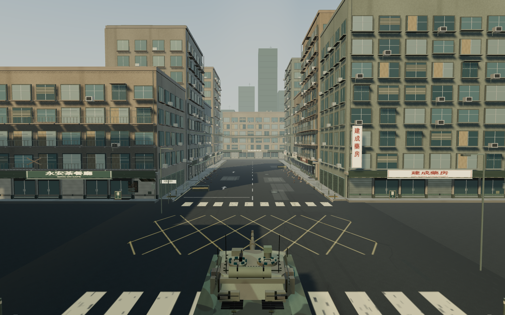
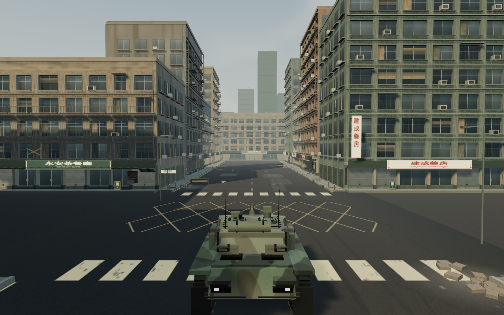

# 寫實樣板：完成品質深度優化

2026-10-15。本輪延續已確認的獨立樣板方向；不取代正式遊戲。此前 115 項紀錄屬上一輪，不作本輪完成證據。

## 討論決定

三個指定 `gpt-6-astra/max` 工作階段分別檢查炮火、街景及成品質素。避免以新增項目數量代替品質；採取以下有界改動：

1. 街廓：以不同外牆分段、窗洞陰影、生活痕跡及遠景遮擋減少規則方塊感，沿用合批及既有碰撞。
2. 炮火：炮管機構及高速彈道已有回歸保障，本輪集中處理炮口氣流、壓力揚塵的時序與障礙淨空，維持粒子上限。
3. 鏡頭：檢查較低追尾視角能否改善重量及尺度感，同時保留近牆避障、手機瞄準及獨立觀察。

未採用全面重建引擎／大量添加戰損物件：前者超出本輪，後者會增加渲染成本及可能改變通路。程序模型仍不能冒稱掃描資產或大廠成品。

## 實作及驗收計劃

- 場景代理只修改 realism-world/materials/sky；炮火代理只修改 effects/effect-math 及自己的測試；主代理負責鏡頭與整合。避免共同改同一檔。
- 炮火先重現近牆煙氣越界，再檢查時序、固定池及舊特效回歸。
- 場景保持 15 個碰撞障礙及既有通路；檢查合批數量和日／黃昏畫面。
- 最終只執行 `build:realism`。重跑規則、六關模擬及樣板離線瀏覽器流程。
- 新證據存 `docs/evidence/finish-pass/`；舊 HTML 與舊測試 harness 已保存為 before 檔。
- 同場景比較需要完整繪圖；受控時鐘／略過中間繪圖的操作測試不可當作實機 FPS。
- 正式 HTML 的基準 SHA256：`25a0c1503e7ce7ac22c7231c0ca6291f0855dc1bf13c468edaafee6aa364f6b9`。

## 完成標準及限制

可交付本輪必須有實際畫面覆核、相關測試通過、離線成品一致；每個失敗需說明並處理。商用完成仍需目標裝置實測、真人操控與試聽、更多手工資產及完整內容驗收，不能以單元測試或自評代替。

## 首輪實圖覆核

追尾高度由固定 8.2 米改為預設距離下 6.1 米；坦克車尾能完整入鏡，近牆時逐漸抬高。窗洞內縮及立面分段已可見，但第一輪仍有後方天際線缺口，玻璃亦有重複的階梯狀圖案。這兩項列為本輪修正，不把首次建置當成完成；首輪圖片另存 `first-pass-garage.png` 與 `first-pass-drive.png`。

炮煙採靜態障礙的保守掃掠檢查，近牆可能少出一部分煙塵；沒有模擬流體繞流或煙霧撞上移動車體。原有炮管後座及 1,720 m/s 樣板彈道保留，本輪未宣稱重做它們。

後續實圖已確認補齊後方遠景、移除玻璃硬邊圖案；最後加入較低的遠景地面，閉合道路盡頭與樓宇之間的天空細縫。這些幾何仍不參與碰撞。修改後場景的 6 項測試、前輪 9 項細節測試及 TypeScript 建置通過。

## 效能證據的限制

本輪完整繪圖比較執行時，已觀察到其他不屬本任務的 Chromium 繪圖程序；沒有停止其他工作。`visual.log` 的時間是共享伺服器負載下的小樣本，不能作隔離效能比較或實機 FPS 結論。繪圖呼叫、三角形及資源數量仍可用作場景複雜度核對；前後預設鏡頭高度不同，不能把預設鏡位的量差當成完全同鏡位比較。

整批繪圖程序在新版本取樣途中收到 SIGTERM（exit 143），原因未確定；已完成的六張前後截圖保留，這次整批不能計作通過。餘下鏡頭／炮火與成品操作改以分段驗證，避免重做已完成項目。`realism-browser.mjs` 新增可選 `--viewport=1440|1280|390|844|820` 及 `--encounter`；每段獨立輸出結果並綁定相同 HTML 雜湊，無參數仍執行原完整流程。

## 已完成的畫面檢查

- `visual-details-camera.json`：十個完整渲染案例、三十組比例投影檢查通過，包含 12／22 米距離、四個方向及近牆避障。
- `visual-details-muzzle.json`：同一發射輸入後 20／80／200／450 ms 四個完整渲染通過，炮焰消退後留下局部煙氣；不是即時影片或真人手感驗收。
- 三種視窗的前後截圖已查看；玻璃重複圖案、後方空白及地面細縫已修正。街口兩側仍有較疏落的地面，車體及建築仍呈程序化風格，不能宣稱全面寫實完成。
- 兩份分段畫面結果均無瀏覽器錯誤或外部請求。

桌面操作首跑在前進斷言失敗。覆核確認原生對話框的 `close` 事件會晚於按鈕點擊完成；測試原本可能在恢復／清除輸入之前按下 W。已在測試中等候原生事件，保留原有速度斷言及額外診斷；遊戲程式未因此改動，首跑失敗日誌保留。

## 最終交付驗證

- 最終離線成品的五種視窗操作通過：1440×900、1280×577、390×844、844×390、820×1180；涵蓋鍵盤、觸控、開火、暫停及返回。無 JavaScript 錯誤或外部素材請求。
- 另以相同來源核心的輸入式測試完成街口交火：8 發、6 次命中、擊毀兩車並勝利；不是真人完整遊玩驗收。六次重開後幾何及紋理數量保持一致，模擬 HOTAS 校準、油門及扳機通過。
- 原有規則及六關模擬回歸通過；新增鏡頭 3 項、炮火 8 項、場景 6 項、樣板彈道 14 項檢查通過。
- `scripts/finish-report.mjs` 已核對五種版面、八組瀏覽器結果與兩份畫面細節結果，並確認成品與建置檔逐位元相同，正式 HTML 未變。彙總為 `evidence/finish-pass/release.json`。
- 成品 SHA256：`e97aae251edcb8a693b57b0f66a4e26245dc0be4b689614e034187b5a0e9af39`。
- 本輪沒有更換聲音或重寫後座機構，沒有公開發布或替換正式版。完整效能比較中斷，未驗證 Windows／手機／平板實機、實體 HOTAS 或真人手感，仍不屬大廠完成品。

### 桌面前後對照

上輪（8.2 米追尾視角）：

本輪（預設 6.1 米追尾視角）：

