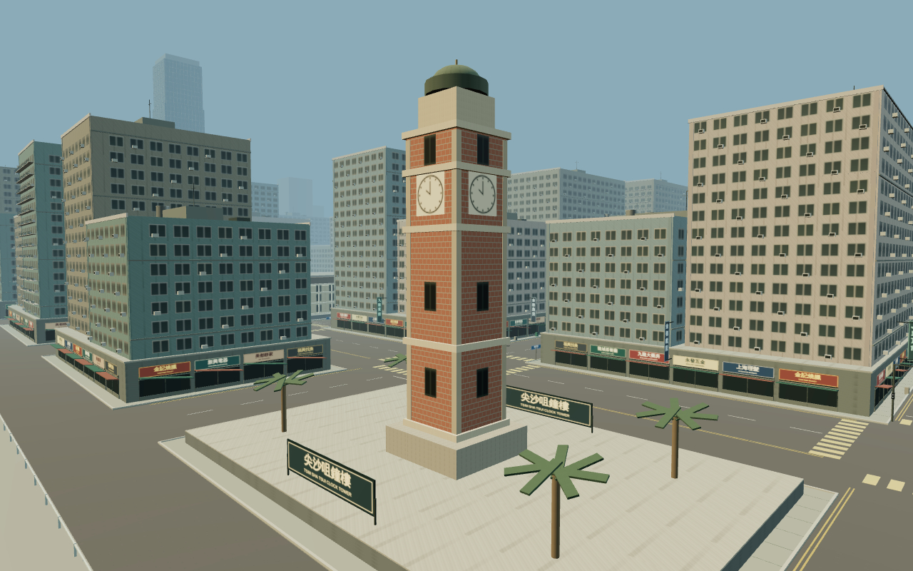
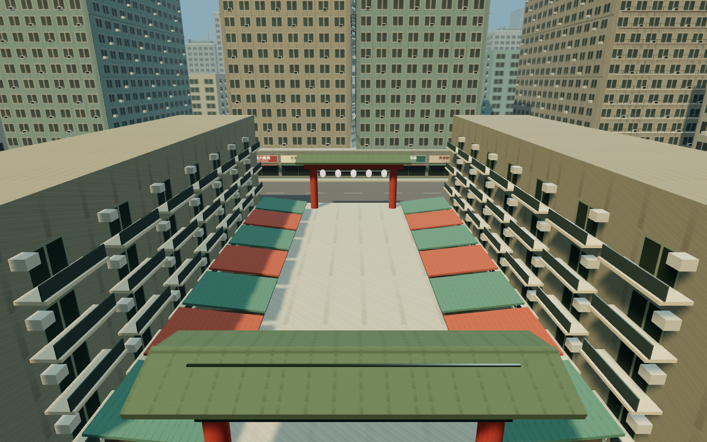
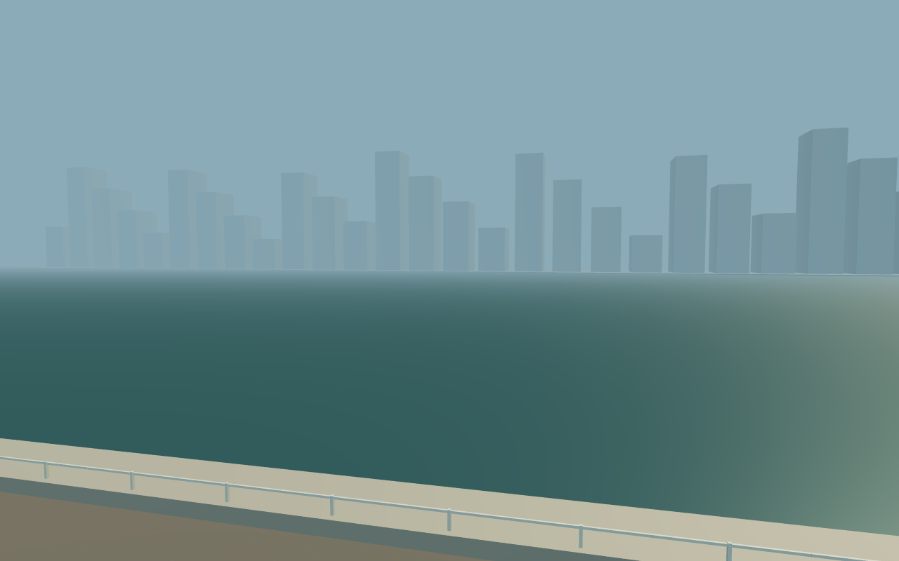

# 九龍街景與戰場聲音 1.4

執行方式：本對話獨立實作，不委派代理。保留單檔離線、30 車、六關、四模式、HOTAS、存檔格式及既有戰鬥平衡。

## 設計及驗收

- [x] 用具辨識度的地標取代六個重複街廓：鐘樓、舊油麻地警署、廟街、旺角市集、深水埗唐樓、西九 ICC。主路網及任務出生點不變；旺角、深水埗中央小巷可通行，建築／攤檔／路牌柱有個別碰撞。
- [x] 全部敵車按突擊／側襲／支援裝備外觀分類加識別構件，保留型號特徵；損毀及低耐久有持續煙霧。沿用既有 AI 戰術，用合批模型及有上限的粒子池控制成本。
- [x] 分層炮聲、距離延遲、建築遮擋、街谷回響、機械履帶；原創自適應低音／打擊／旋律，音樂可獨立關閉。暫停、失焦及返回車庫靜音，限制同時聲源。
- [x] 驗證地標位置及路網、所有車型敵我外觀隔離、音量舊設定相容；離線瀏覽器畫面、戰鬥、音訊渲染峰值與暫停；重跑原規則及六關。
- [x] 重建成品並保存截圖／量測；驗證附件的 SHA-256 與交付 HTML 相同。發布目標為既有 GitHub `main` 與 Pages，遠端核對另於交付時執行。

## 參考資料與轉譯

所有模型、貼圖和聲音由程式原創；下列照片／商業遊戲錄音不嵌入成品。

- 香港旅發局 [鐘樓](https://www.discoverhongkong.com/eng/place-to-go/travel.guide-clock-tower.html)：紅磚、花崗岩、四面鐘及頂部；遊戲主塔以約 44m 輪廓呈現。
- 香港旅發局 [油麻地舊警署](https://www.discoverhongkong.com/eng/place-to-go/culture/old-yau-ma-tei-police-station.html)：歷史低層警署，淺色牆、長廊與古典立面。
- 香港旅發局 [廟街](https://www.discoverhongkong.com/eng/place-to-go/travel.guide-temple-street-night-market.html)：牌樓、燈籠、市集棚架及店招。
- 香港旅發局 [九龍社區](https://www.discoverhongkong.com/eng/neighbourhoods/kowloon.html)：旺角、深水埗街舖與密集街廓，原創唐樓露台、冷氣機、棚架及雙語招牌。
- 香港旅發局 [ICC](https://www.discoverhongkong.com/eng/place-to-go/travel.guide-international-commerce-centre.html)：西九垂直玻璃塔樓；為遊戲視野壓縮高度，並非測繪模型。
- World of Tanks [音樂設計](https://worldoftanks.com/en/news/general-news/update-1-0-new-music/)：參考地域氣氛、戰鬥動態分層；本作使用自行編寫音列及合成器，不使用原曲。
- World of Tanks [音效回饋](https://worldoftanks.com/en/news/general-news/9-16-sound/)：參考不同事件可辨識的聲音提示，本作以合成低頻、瞬態及尾音實現。

這是受香港啟發的虛構撤空演習區。六個地標不代表真實地理相鄰、道路比例或完整實景掃描。沒有加入平民作戰目標。

## 驗證範圍

- `npm test`：9 項原模擬、10 項擴充、21 項戰術、7 項部署、5 項本輪檢查，共 52 項；另有完整城市六關固定輸入通關。新增測試檢查兩個市集巷道實際駕駛通行、攤檔阻擋炮彈、30 款敵我模型隔離、受損塗裝重複更新／修復，以及舊音量設定相容。
- `npm run test:hong-kong`：六地標、海港及敵車示範以來源模組生成的獨立測試頁截圖；正式離線 HTML 驗證配樂音量保存、1440×900／1280×577／390×844、開火及暫停，檢查 JavaScript 錯誤與外部請求。測試頁的 `qa` 不會打包到成品。
- 聲音：Chromium 的 OfflineAudioContext 實際渲染 8 秒雙聲道合成聲景，驗證非空輸出、峰值低於削波、左右聲道不同及暫停後尾段靜音；不聲稱已真人試聽。
- 效能：只記錄 1280×800 平衡畫質、四敵交戰中的 12 幀短樣本及幾何提交量，沒有同環境基準，不能宣稱幀率提升或 Windows 實機達標。煙霧池固定 128 粒，既有爆炸池上限 20、塵埃 96；瞬態音效最多 16 個來源，配樂最多 12。
- 今輪沒有重跑 1.3 的全部備份匯入／HOTAS／長時間瀏覽器測試；相關既有單元測試有重跑。Windows 顯示卡、實體 HOTAS、觸控駕駛、真人耳機／喇叭聽感未驗證。

原始結果在 `.omo/evidence/hong-kong/`；最終 HTML 的 SHA-256 及數值見 [驗證附件](hong-kong-validation.json)。[8 秒合成音效預覽](screenshots/hong-kong/soundscape-preview.wav) 是程式渲染的測試音段，不是實車錄音。

