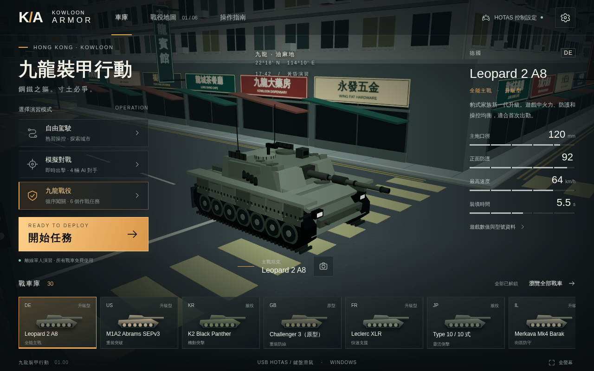
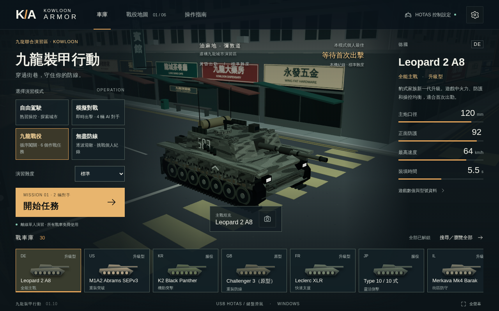
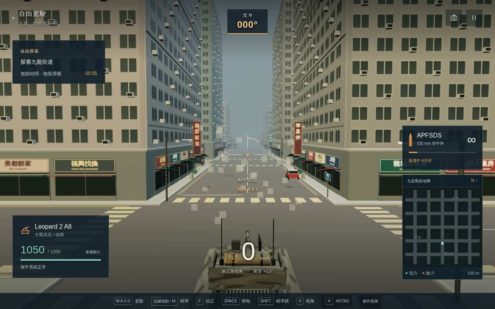
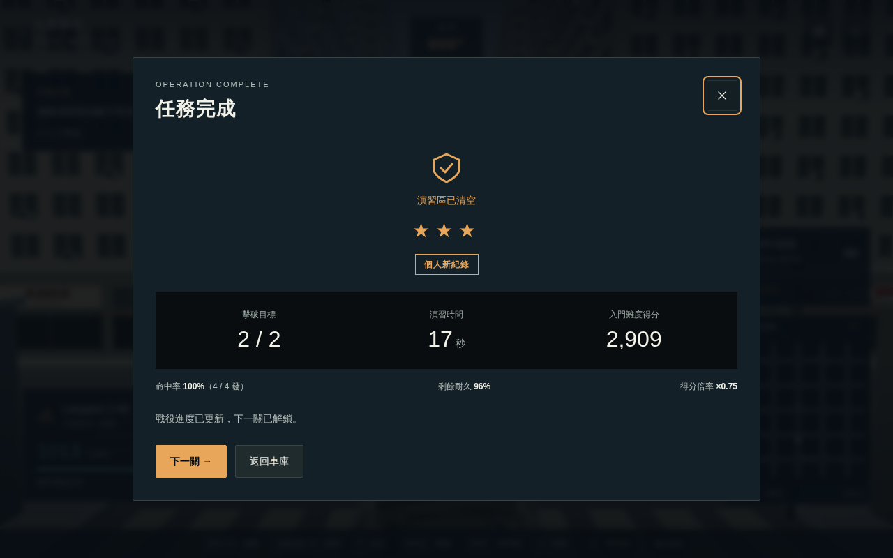
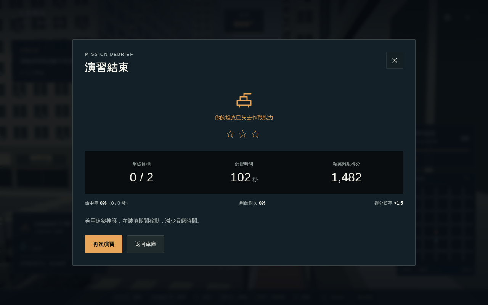

# 1.1 版本驗證紀錄

日期：2026-10-11。基線版本：`0ee1c1d2d5fa7e0410a45292633ade0b70ddd943`。

## 交付範圍

- 保留 30 款坦克、四個程序模型家族、自由駕駛、四敵模擬對戰、六關戰役及原有進度。
- 新增無盡防線、三種難度、安全隨機出生點、波間整備與分難度最高分。
- 車庫重整出擊層次、選中戰車固定留在列表；HUD 加入實際方位、裝填環、命中確認及波次資訊。
- 原創程序迷彩、磨損、編號、載物、炮管後座；街站、長櫈、設施箱、渠蓋及路面修補。
- M 鎖定滑鼠、F 炮塔回正、靈敏度／反向／減少動態效果，以及可儲存畫質和音量。
- 高密度窗框轉為程序紋理，城市細節按區域剔除，14 個車輪合成一個動畫批次；重用向量、靜態矩陣及敵軍 HUD 標記。

所有模型及新增紋理均在程式內生成，沒有新增外部下載素材。離線 HTML 為 968,083 bytes（約 0.92 MiB；原版 942,152 bytes）。

## 自動化驗證

`pnpm build`、`pnpm test` 及 `git diff --check` 通過。測試共 19 項：原有模擬 9 項、新增 10 項，零失敗。

新增測試涵蓋 100 個出生點種子、難度不改玩家車輛性能、波次／暫停／一次回血／八敵上限、舊存檔兼容、分難度紀錄、拒絕儲存容錯、區域批次座標與包圍球、輪組批次釋放、AI 在掩體後繼續行駛、六關及隨機模式全城碰撞檢查、真實敵火戰敗及重試狀態。

### 離線成品實際操作

`node scripts/browser-check.mjs`：Linux headless Chromium 141.0.7390.37，斷網後以 `file://` 開啟交付 HTML。17 組檢查全部通過：

- 四種模式；30 款車、搜尋、原型選車及選中卡片保留。
- 1280×800、960×640、768×900、375×812 無橫向溢出，出擊控制不與戰車列表重疊；窄屏使用捲動。
- 畫質、滑鼠靈敏度及反向設定重載保留。
- 真實鍵盤加速至 13 km/h、煞車、倒車、炮塔旋轉／回正、三個視角、瞄準鏡及開炮裝填。
- M 取得滑鼠鎖定、Esc 釋放並暫停；暫停時計時不動。失焦暫停、HOTAS 面板及預設切換。
- 精英難度四敵對戰、入門生存模式可出擊。
- 入門首關以持續按住 Space 實際擊破兩輛敵車：4 發命中、17 秒遊戲時間、剩餘 96% 耐久、2,909 分；下一關成功開始，解鎖與成績在重載後保留。
- 零 JavaScript 頁面錯誤，零 HTTP／HTTPS 素材請求。

原始結果：[browser-check.json](evidence/browser-check.json)。

### 戰敗及重試整合

`node scripts/defeat-check.mjs` 在獨立瀏覽器測試頁載入真正的 Game、全城碰撞、Interface 及 View，不改寫耐久、命中或結局。為避免軟件繪圖令等待過長，這項測試只加速固定步進物理，不渲染每個中間畫面。

玩家沒有開火，精英敵軍於 102.4 秒模擬時間將耐久降至 0；實際顯示戰敗對話框。按「再次演習」後回復遊玩狀態、1,050／1,050 耐久、0 秒，以及原有精英難度。零頁面錯誤。這不是即時逐幀完整戰敗錄影；首關勝利則來自上一節的成品實際按鍵流程。

原始結果：[defeat-check.json](evidence/defeat-check.json)。

## 效能量度方法

`node scripts/benchmark.mjs baseline`／`final` 使用相同 Chromium 141、1280×800、DPR 1、關閉展示自動晃動，在車庫及停車的自由駕駛場景，各取 12 個 frame。原始 WebGL 提交量包含陰影 pass，frame time 為 RAF 間隔。

本環境的繪圖器為 **ANGLE / Vulkan / SwiftShader（Subzero，軟件繪圖）**，不是玩家的實體顯示卡。每個場景只作短樣本，frame time 會受虛擬機負載影響；不能推算 Windows 幀率或聲稱穩定 60 fps。低畫質前後均關閉陰影；新版「平衡」陰影由 2048² 改為 1024²，「高畫質」仍為 2048²。城市結構保留投影，密集小型窗框改為紋理及不投影細節。

| 畫質／場景 | 每幀三角形：原版 → 1.1 | 減幅 | Draw calls：原版 → 1.1 | 中位 frame time：原版 → 1.1 |
| --- | ---: | ---: | ---: | ---: |
| 平衡／車庫 | 2,644,842 → 317,546 | 88.0% | 104 → 139 | 4,099.8 → 983.3 ms |
| 平衡／自由駕駛 | 2,646,458 → 441,542 | 83.3% | 113 → 187 | 5,366.4 → 1,716.6 ms |
| 流暢／車庫 | 1,595,958 → 225,302 | 85.9% | 63 → 87 | 2,999.9 → 950.0 ms |
| 流暢／自由駕駛 | 1,597,574 → 349,298 | 78.1% | 72 → 135 | 3,733.2 → 1,449.9 ms |

在這四個樣本中，三角形提交量降低 **78.1–88.0%**，中位 frame time 降低 **61.2–76.0%**。代價是區域分批及新增模型配件令 draw calls 增加；優化重點是減少無用頂點和高密度細節的陰影成本，而不是宣稱所有指標都下降。軟件繪圖仍明顯慢於正常遊玩所需，實體顯示卡表現有待量度。

原始資料：[基線](evidence/benchmark-baseline.json)、[1.1 最終量度](evidence/benchmark-final.json)，包含 P95 及環境資訊。量度時沒有其他測試瀏覽器並行。

離線成品 SHA-256：`a3967057555409e606092da06bf6f78fcd6a8cfaa4e634495121b72b9f4a49aa`。
基線成品 SHA-256：`56edd7de7aae1a8575d162c800a875c30c5bf4d37c970a6e6179b816eef79a50`。

## 畫面證據

改良前的車庫：

1.1 車庫，相同平衡畫質及視窗：

實際駕駛、裝填與 HUD：

離線成品首關過關：

固定步進整合測試的戰敗對話框：

## 限制與手動檢查

- 本輪沒有 Windows 實機、Edge 或 USB HOTAS 硬件，不能聲稱已完成實體搖桿驗證。原有多裝置、軸校準、死區及安全中立機制保留；瀏覽器測試只覆蓋設定介面。
- 尚未以實際操作逐關完成全部六關，亦未長時間遊玩高波次；其出生位置及波次規則已有確定性測試。
- 375 px 窄屏只驗證介面可瀏覽，沒有新增觸控駕駛。
- 瀏覽器 `file://` 儲存行為依實作而異；移動檔案或更換瀏覽器可能失去原有紀錄。
- 在 Windows 使用者的硬件上，仍宜確認滑鼠鎖定、全螢幕、音量、HOTAS 各軸及長時間高波次表現。
