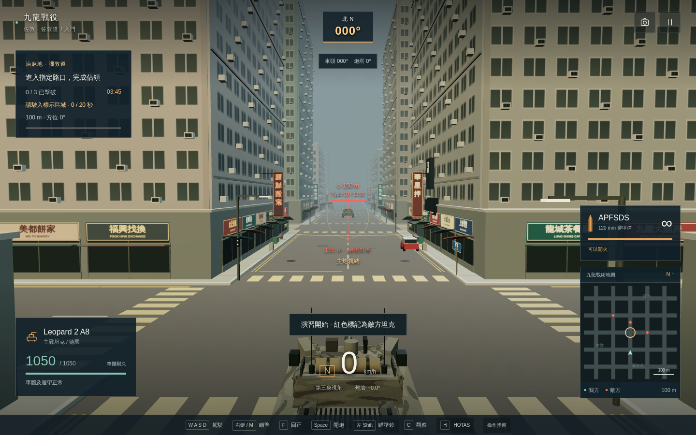
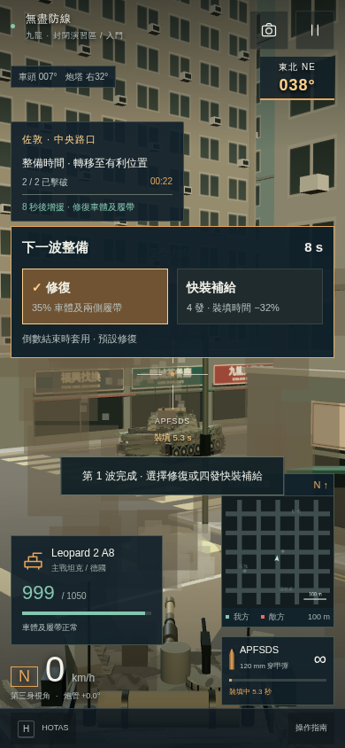

# 1.2 戰術升級驗收

日期：2026-10-11。基準版本：`8ed3961`。實作／驗收：單一 gpt-6-astra、max；沒有另派代理。

## 改動與保留項目

- 炮彈按飛行方向計算裝甲，掃描車體、炮塔、左右履帶；履帶限制機動、停車六秒修復，命中顯示方位及部位。
- 滑鼠位移保存到真正的固定步進；獨立觀察、16 項改鍵／恢復預設、鏡倍率與按住／切換、HUD 大小。
- AI 包抄後推進、裝填找掩護、低耐久撤退；車身淨空路徑及路口到達判定有回歸。難度影響反應與追蹤，不只 HP／傷害。
- 六關分為清場、佔點及守區；生存波間有修復／四發快裝選擇。保留 30 車、四模式、逐關解鎖、舊紀錄、HOTAS 校準與單檔離線。
- 代表車構件、左右履帶、五區地標、有限煙塵、方向炮聲及裝填提示；全部原創程序素材，沒有新增依賴。

## 測試分層

| 層級 | 驗證 |
| --- | --- |
| TypeScript／打包 | `pnpm check`、`pnpm build`；獨立 HTML 與 `dist/index.html` 相同，沒有測試接口 |
| 單元／規則 | 40 項：原模擬 9、新版原有回歸 10、戰術回歸 21 |
| 完整城市六關 | `scripts/campaign-check.mjs`；60 Hz、入門、Leopard 2 A8，以駕駛及開火輸入完成六關，每步檢查真實建築淨空 |
| 離線正式成品 | `scripts/browser-check.mjs`，20 項檢查；四模式、30 車、設定／改鍵保存、操控／開火、首關勝利、下一關／重新載入解鎖；零錯誤／零 HTTP 素材 |
| 真實受擊失敗 | `scripts/defeat-check.mjs`；精英首關不反擊，107.72 秒車體降至零；重試回復 1050 HP、0 秒，難度保留 |
| 新流程與穩定性 | `scripts/tactical-browser.mjs`，8 組檢查；新目標勝敗／重試、波間快裝、4 倍鏡、HOTAS、雙視窗及固定步進穩定性 |
| 最終單檔核對 | `scripts/artifact-check.mjs`，3 項檢查；正式 HTML 快速重開 HOTAS、真實開炮及 390 HUD、捲動後關閉設定；零錯誤／零 HTTP／零測試接口 |

規則單元會直接設置傷害／區域狀態，以隔離測試成功、失敗、爭奪、暫停、重試及補給效果。**六關輸入式驗收、瀏覽器任務／生存和受擊失敗則沒有改寫 HP、位置、裝填或結局。** 新流程測試頁只預先提供合法舊存檔 `completed=5`，以存取六關選單；正式單檔另外從空存檔測試真實解鎖。測試接口只存在於 `.omo/evidence/*-harness.html`，不進入成品。

### 六關結果

| 關卡／目標 | 時間（秒） | 剩餘 HP | 擊破 |
| --- | ---: | ---: | ---: |
| 1 清場 | 16.85 | 1002 | 2／2 |
| 2 佔點 20 秒 | 79.87 | 936 | 3／3 |
| 3 清場 | 65.58 | 656 | 4／4 |
| 4 守區 45 秒 | 45.02 | 752 | 4／5 |
| 5 佔點 30 秒 | 124.15 | 567 | 6／6 |
| 6 守區 60 秒 | 68.42 | 160 | 4／8 |

末關自動駕駛在區內四點每五秒改變巡守位置，防線剩 32.8%。定點不動的策略會被突破；沒有為測試調低耐久、傷害、敵軍或目標秒數。第 4／6 關在敵軍仍存活時勝利，並非「清場」換名字。這是入門難度下可重現的完成路徑，不代表全部車型／難度經人工平衡。

### 根因回歸

先寫失敗測試，再修正並保留回歸：

- 同一發已離膛炮彈，發射者之後轉 180° 不得改變傷害；原版會改變。
- 30／60／144 Hz 渲染輸入同樣 240 像素鼠移，一秒均消耗 60 次物理步進，炮塔結果一致；大鼠移也不再被夾成鍵盤軸。
- 路徑需避開擴張 2.3 m 的實際車身碰撞邊界；第五關原測試會在街角卡住。另防止 3 m 路口距離被過早當作已到達。
- 目標指令不得取消包抄／撤退；到達包抄路口後須推進，不能永遠停在側路。精英的追蹤／重新判斷比入門快，確定性測試直接驗證。
- 關閉對話框後立即重開 HOTAS，原本排隊中的舊 `close` 事件會刪去新設定面板。最小重現得到「dialog 仍 open、label 數量 0」；現在忽略已重開對話框的舊關閉事件，瀏覽器保留同一回歸。
- 佔點殺光敵軍仍要到場；守區被敵軍佔據會失守；重試清除進度、耐久損失及補給 charges。
- 快裝剛好四發 ×0.68，第五發恢復正常；修復回復最大 HP 的 35% 及兩側履帶，兩者不能同波兼得。

## 介面與設計檢查

按 [六步計劃](tactical-upgrade-plan.md) 讀取六項指定技能；全部在本機存在。保留產品既有炭灰、琥珀、薄荷綠與離線系統字體，不套用通用營銷配色。原生表單、焦點、可關閉對話框、減少動態與響應式檢查參考 [Web Interface Guidelines](https://github.com/vercel-labs/web-interface-guidelines/blob/main/command.md)。

實際查看 1440×900 及 390×844 截圖，包括車庫、佔點 HUD、波間選擇及設定；另自動檢查 1280×800、960×640、768×900。車庫沒有橫向溢出／出擊按鈕與車庫列重疊。390 採縱向捲動，保留設定及返回操作，調整小地圖／彈藥資訊間距與固定對話框標題／關閉列。沒有新增觸控駕駛；窄畫面可瀏覽及設定，駕駛仍需鍵盤／控制器。

## 效能與原始證據

相同 1280×800、DPR 1 的基準／新版車庫及自由駕駛由 `scripts/benchmark.mjs` 量測；新增有敵軍、炮火與爆炸的戰鬥樣本另列，**不把無敵軍的靜態基準與新戰鬥場景直接比較**。20 分鐘固定步進加速作戰、稀疏實際渲染、十次重開後的 renderer 資源及 GC 後 heap，由新整合測試記錄。

| 相同場景 | WebGL 提交量：前 → 後 | 增幅 | 三角形：前 → 後 |
| --- | ---: | ---: | ---: |
| 平衡／車庫 | 139 → 146 | +5.0% | 317,546 → 316,462 |
| 平衡／自由駕駛 | 187 → 197 | +5.3% | 441,542 → 440,464 |
| 流暢／車庫 | 87 → 92 | +5.7% | 225,302 → 225,594 |
| 流暢／自由駕駛 | 135 → 143 | +5.9% | 349,298 → 349,596 |

四組各取 12 幀，包含陰影提交，均低於 +25% 預算。新版 SwiftShader 中位數依表格順序為 966.6／1266.6／783.3／1133.3 ms；原始 p95 亦保存，**不據此聲稱實機加速或流暢幀率**。

新戰鬥樣本為第六關 4.1 秒、8 輛存活敵車、1 發／1 次命中及 2 組煙塵，1440×900 流暢畫質：190 次提交、374,802 三角形及 160 點。六次重繪相同戰鬥狀態的 `renderTimesMs` 只量 CPU 提交加一次 `requestAnimationFrame` 等待，**沒有等待 GPU 完成，不能當作連續作戰幀率，亦不能與上表的幀間隔比較**。未取得升級前相同戰鬥場景的對照。

穩定性樣本完成 72,000 次固定步進（1,200 秒模擬）、18 次回合結束／重開、207 發炮彈及 173 次命中；每 300 秒模擬時間才實際渲染一次，迴圈牆鐘約 8.05 秒。完成後再重開十次，車庫幾何資源均為 13，紋理為 24；測試前為 22 張，載入不同車型後增加 2 張，重開不再增加。GC 後 heap 約 16.75 → 16.61 → 16.65 MB；戰鬥中未 GC 的四次樣本為 26.29–30.27 MB。這只是有限資源觀察，不是長時間實機渲染承諾。音效在加速穩定性迴圈停用，沒有聲音資源壓力測試。

合成 HOTAS 分開搖桿／油門裝置，驗證待機零速、校準、前進／倒車、炮塔軸、按住視角鍵只切換一次、暫停／斷線及重新載入設定。雙視窗各自保持模式，失焦會暫停。正式 390 單檔截圖量得小地圖下緣 708 px、彈藥上緣 718 px；設定捲到底後關閉按鈕仍在 y=42.77 px。

彙整檔：[manifest](evidence/tactical/manifest.json)。完整數據：[新流程／穩定性](evidence/tactical/tactical-browser.json)、[正式離線成品](evidence/tactical/browser-check.json)、[最終單檔](evidence/tactical/artifact-check.json)、[六關](evidence/tactical/campaign-check.json)、[基準](evidence/tactical/benchmark-tactical-baseline.json)、[新版](evidence/tactical/benchmark-tactical-final.json)。`node scripts/collect-tactical-evidence.mjs` 會核對 HTML 大小、SHA-256、零測試接口、所有任務結果及 +25% 提交量預算，再保存精選報告和截圖。

## 限制

- 本次是 Linux headless Chromium／SwiftShader，未驗 Windows、實體 HOTAS、實機 144 Hz 顯示器或多聲道喇叭。合成 Gamepad 與 144 Hz 調度回歸不是硬件實測。
- 20 分鐘是 72,000 次固定步進，不是 20 分鐘連續實時渲染。SwiftShader 幀時間不能當作玩家顯示卡 FPS；有限 heap／GPU 資源觀察亦不是所有記憶體問題均不存在的證明。
- 模型仍為四個程序化家族；裝甲、音效及物理為簡化遊戲規則。沒有護送、多人、外部素材、完整穿甲／彈種或可破壞城市。
- 沒有取得完整模型用量；`_team_runs/runs.jsonl` 記錄實際可取得的時間、角色、模型／reasoning、產物及 `usage: null`，不推算缺漏 token。
